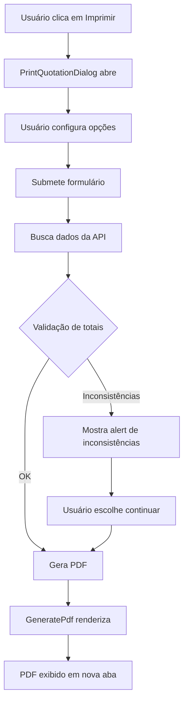

# Geração de PDF - Orçamentos, Ordens de Serviço e Fichas de Produção

## Visão Geral

O sistema utiliza a biblioteca `@react-pdf/renderer` (versão 4.3.0) para gerar PDFs de documentos comerciais. A geração é feita através de um componente unificado que suporta três tipos de documentos:

- **Orçamentos** (`quotation`)
- **Ordens de Serviço** (`order`) 
- **Fichas de Produção** (`production`)

## Arquitetura

### Componentes Principais

#### 1. PrintQuotationDialog (`src/components/common/PrintQuotation/PrintQuotationDialog.tsx`)
- **Função**: Interface de configuração de impressão
- **Responsabilidades**:
  - Apresenta opções de impressão configuráveis
  - Valida inconsistências nos totais do orçamento
  - Busca dados da API endpoint `/sale/quotation/{id}/pdf-data`
  - Controla o fluxo de geração do PDF

**Opções de impressão disponíveis:**
- Exibir imagens dos produtos
- Exibir dimensões/medidas
- Exibir valores unitários
- Exibir descontos
- Exibir valores finais
- Exibir valores totais
- **Exibir especificações de pagamento e entrega** *(controla formato detalhado vs genérico)*
- Exibir detalhamento dos itens

#### 2. GeneratePdf (`src/components/common/PrintQuotation/GeneratePdf.tsx`)
- **Função**: Componente de renderização do PDF
- **Responsabilidades**:
  - Renderiza o layout do documento PDF
  - Adapta o conteúdo baseado no tipo de documento
  - Aplica estilos e formatação
  - Processa dados das composições de produtos

### Tipos de Documento

#### Orçamento (`quotation`):
- Exibe todas as informações financeiras
- Inclui assinaturas e termos
- Mostra detalhes completos de pagamento e entrega

#### Ordem de Serviço (`order`):
- Similar ao orçamento mas com status "Ordem de Serviço"
- Mantém informações financeiras
- Indicação visual diferenciada (cor verde)

#### Ficha de Produção (`production`):
- **Layout simplificado** para uso na produção
- Remove informações financeiras (valores, descontos, totais)
- Foca em informações técnicas:
  - Composições dos produtos
  - Quantidades
  - Dimensões e especificações
- Remove seções de pagamento, assinaturas e textos comerciais

## Implementação

### Pontos de Acesso

#### 1. Orçamentos
- **Localização**: `src/app/(app-sidebar)/vendas/orcamentos/[quotationId]/components/QuotationActions/index.tsx`
- **Tipos disponíveis**: `quotation`, `order`, `production`

#### 2. Ordens de Serviço
- **Localização**: `src/app/(app-sidebar)/vendas/ordens-de-servico/[orderId]/components/OrderActions/index.tsx`  
- **Tipos disponíveis**: `order` (via do cliente), `production` (via de produção)

#### 3. Agenda de Entrega (Produção)
- **Localização**: `src/app/(app-sidebar)/producao/agenda-de-entrega/components/DeliveryScheduleTable/DeliveryScheduleData.tsx`
- **Tipo**: `production` (ficha de produção)
- **Implementação direta**: Não usa o PrintQuotationDialog, chama GeneratePdf diretamente

### Fluxo de Geração



### Estrutura de Dados

#### Endpoint de Dados
```
GET /sale/quotation/{quotationId}/pdf-data
```

#### Tipos TypeScript
- **PrintQuotationType**: Tipo principal definido em `src/types/print/quotation.ts`
- **PrintOptionsType**: Opções de configuração do PrintQuotationDialog

#### Principais Entidades:
- **Company**: Dados da empresa (logo, contatos, endereço)
- **Client**: Dados do cliente
- **Contact**: Contato responsável  
- **Quotation**: Dados do orçamento/ordem
- **QuotationItems**: Itens com produtos e composições
- **Delivery**: Informações de entrega
- **Payment**: Condições de pagamento + `availablePaymentConditions[]` (opcional)
- **Total**: Totais financeiros

## Bibliotecas e Dependências

### @react-pdf/renderer (v4.3.0)
- **Document, Page**: Estrutura base do PDF
- **View, Text**: Elementos de layout
- **Image**: Renderização de imagens
- **StyleSheet**: Sistema de estilos similar ao CSS

### Utilitários
- **formatCurrencyToBrl**: Formatação de moeda
- **calculateQuotationTotals**: Cálculos financeiros
- **adaptNewItemsToOldFormat**: Adaptação de dados da API
- **validateQuotationTotals**: Validação de inconsistências

## Características Técnicas

### Validação de Inconsistências
O sistema valida se os totais calculados batem com os armazenados no banco:
- Subtotal dos itens
- Total de descontos
- Total final

Se há inconsistências, o usuário é alertado mas pode prosseguir, e o PDF usa os valores corretos calculados.

### Adaptação de Composições
As composições de produtos são adaptadas para o formato esperado pelas funções utilitárias através da função `adaptCompositionForDisplayUtils`.

### Layout Responsivo
O PDF adapta colunas e informações baseado no tipo:
- **Produção**: Layout mais simples, foco em dados técnicos
- **Comercial**: Layout completo com informações financeiras

### Estilos
Utiliza StyleSheet do react-pdf com:
- Fontes: Helvetica
- Cores: Sistema de cores consistente
- Layout: Flexbox para posicionamento
- Páginas: Formato A4 com cabeçalho fixo

## Manutenção e Extensão

### Para adicionar novos tipos de documento:
1. Estender o tipo `'quotation' | 'order' | 'production'` 
2. Adicionar lógica condicional no GeneratePdf
3. Implementar ponto de acesso na interface

### Para modificar layout:
- Editar estilos no StyleSheet do GeneratePdf
- Ajustar condicionais de renderização baseadas no tipo
- Testar em todos os tipos de documento

### Para adicionar novas opções de impressão:
1. Atualizar o tipo PrintOptionsType
2. Adicionar checkbox no PrintQuotationDialog  
3. Implementar lógica no GeneratePdf
4. Atualizar valores padrão se necessário

## Detalhamento dos Blocos de Informações do PDF

### 1. Cabeçalho (Header) - Fixo em todas as páginas

**Localização**: Topo da página, sempre visível
**Cor de fundo**: Cinza claro (#F2F4F7)

#### Lado Esquerdo (35% da largura):
- **Logo da empresa**: Imagem 80x80px
  - Fonte: `data.company.logo`
  - Fallback: `/src/assets/icons/companyIconPlaceholder.png`

#### Centro (50% da largura):
- **Nome da empresa**: Negrito, fonte 9pt
  - Fonte: `data.company.name`
- **CNPJ**: Formatado com máscara
  - Fonte: `data.company.cnpj` (processado por `maskCnpj()`)
- **Endereço linha 1**: Rua e número
  - Fonte: `data.company.address.street, data.company.address.number`
  - **Produção**: Inclui bairro na mesma linha
- **Endereço linha 2**:
  - **Não-produção**: Bairro, cidade, estado
  - **Produção**: Apenas cidade, estado

#### Lado Direito (25% da largura):
Redes sociais e contatos (alinhados à direita):
- **Instagram**: Ícone + handle (`data.company.socialNetworks.instagram`)
- **Facebook**: Ícone + handle (`data.company.socialNetworks.facebook`)  
- **LinkedIn**: Ícone + handle (`data.company.socialNetworks.linkedin`)
- **Site**: Ícone + URL (`data.company.siteUrl`)
- **E-mail**: Ícone + endereço (`data.company.email`)

### 2. Seção de Informações do Cliente e Documento

**Layout**: 3 colunas de 33% cada

#### Coluna 1 - Cliente:
- **Título**: "Destinado a"
- **Nome**: `data.client.name` (negrito)
- **Documento**: CPF/CNPJ (`data.client.document.value`)
- **Telefone**: `data.client.phone`
- **E-mail**: `data.client.email`

#### Coluna 2 - Contato:
- **Título**: "A/C"
- **Nome**: `data.contact.name` (negrito)
- **Telefone**: `data.contact.phone`
- **E-mail**: `data.contact.email`

#### Coluna 3 - Documento (alinhado à direita):
- **Tipo do documento**:
  - Orçamento: "Orçamento"
  - Ordem de Serviço: "Ordem de Serviço" (verde #039855)
  - Produção: "Ficha de Produção"
- **Número**: `data.quotation.seriesCode-data.quotation.number`
- **Descrição**: `data.quotation.description` (negrito)
- **Datas** (apenas não-produção):
  - Emissão: `data.quotation.createdAt`
  - Validade: `data.quotation.dueDate`
- **Vendedor**: `data.quotation.seller.name`

### 3. Texto Introdutório (Apenas não-produção)

- **Conteúdo**: `data.company.textBeforeItems`
- **Separador**: Linha divisória

### 4. Tabela de Itens

#### Cabeçalho da Tabela:

**Produção**:
- REFERÊNCIA (85%)
- QTD. (15%)

**Não-produção**:
- REFERÊNCIA (35%)
- QTD. ITEM (10%)
- DETALHAMENTO (15%) - se `showDimensions` ativo
- QTD. TOTAL (12%)
- VALOR UN. (9%) - se `showUnitValue` ativo
- DESCONTO (9%) - se `showDiscounts` ativo
- VALOR FINAL (10%) - se `showFinalValue` ativo

#### Linhas de Itens:

**Coluna Referência**:
- **Imagem do produto**: 70x51px
  - Fonte: `item.image.url`
  - Fallback: `/img/product-placeholder.png`
- **Descrição**: `item.description`
- **Composições** (se produção ou `showDimensions`):
  - Nome de cada composição: `comp.name`

**Coluna Quantidade**:
- **Quantidade principal**: `item.product.quantity`
- **Quantidades das composições** (se aplicável)

**Coluna Detalhamento** (apenas não-produção):
- Placeholder "-" para item principal
- **Detalhes das composições**: Formatação de medidas via `generateFormattedQuantityDetails()`

**Coluna Quantidade Total** (apenas não-produção):
- **Total do item**: `item.product.quantity + " un"`
- **Totais das composições**: Calculado via `calculateTotalQuantity()`

**Colunas Financeiras** (apenas não-produção):
- **Valor Unitário**: `item.finalValue / item.product.quantity`
- **Desconto**: `item.totalValue - item.finalValue` (cor laranja #DC6803)
- **Valor Final**: `item.finalValue`

### 5. Seção de Totais (Apenas não-produção)

**Visível apenas se**: `printOptions.showTotalValue` ativo

- **Subtotal itens**: Soma dos valores dos itens
- **Desconto**: Total de descontos aplicados
- **Frete**: `data.delivery.freightPrice`
- **Total**: Subtotal + frete - descontos (negrito)

### 6. Seção de Entrega e Pagamento

**Comportamento condicional baseado em `printOptions.showPaymentDelivery`:**

#### Quando `showPaymentDelivery = true` (padrão):

**Entrega (sempre presente quando ativo)**:
- **Ícone**: Caminhão de entrega
- **Título**: "Entrega"
- **Fornecedor**: `data.delivery.supplier.name`
- **Prazo**: `data.delivery.daysAfterApproval` dias
- **Endereço completo**:
  - **Produção**: Prefixo "R." + endereço completo
  - **Não-produção**: Endereço sem prefixo
  - Fonte: `data.delivery.clientAddress.*`

**Pagamento (apenas não-produção)**:
- **Ícone**: Cifrão
- **Título**: "Pagamento"  
- **Método**: `data.payment.method`
- **Parcelas**: `data.payment.totalInstallments`x

#### Quando `showPaymentDelivery = false`:

**Entrega**: 
- **Completamente removida** do PDF

**Pagamento (apenas não-produção)**:
- **Layout**: Ocupa 100% da largura (ao invés de 50%)
- **Ícone**: Cifrão
- **Título**: "Pagamento"
- **Conteúdo genérico**:
  - "A combinar"
  - Lista de condições disponíveis: `data.payment.availablePaymentConditions` (se disponível)
  - "Valores podem sofrer acréscimo conforme condição de pagamento."

### 7. Seção de Finalização (Apenas não-produção)

#### Texto Pós-Itens:
- **Conteúdo**: `data.company.textAfterItems`

#### Informações de Acordo:
**Lado esquerdo**:
- "Atenciosamente"
- **Nome do cliente**: `data.client.name` (negrito)

**Lado direito**:
- "De acordo, ____/____/______" (campos para preenchimento manual)

#### Assinaturas:
**Duas linhas de assinatura**:
1. **Cliente**: `data.client.name`
2. **Empresa**: `data.company.name` + CNPJ formatado

### 8. Rodapé

**Canto inferior direito de cada página**:
- **Numeração**: "Página X de Y" (fixo em todas as páginas)

## Comportamento Condicional por Tipo

### Ficha de Produção (`production`):
- **Remove**: Valores, descontos, totais, pagamento, assinaturas, textos comerciais
- **Modifica**: Layout da tabela (apenas 2 colunas), endereço com prefixo "R."
- **Mantém**: Informações técnicas, quantidades, composições, entrega

### Ordem de Serviço (`order`):
- **Idêntico ao orçamento** com exceções:
- **Título**: "Ordem de Serviço" em verde
- **Status visual**: Cor diferenciada para identificação

### Orçamento (`quotation`):
- **Layout completo**: Todas as seções e informações
- **Título**: "Orçamento" em texto normal